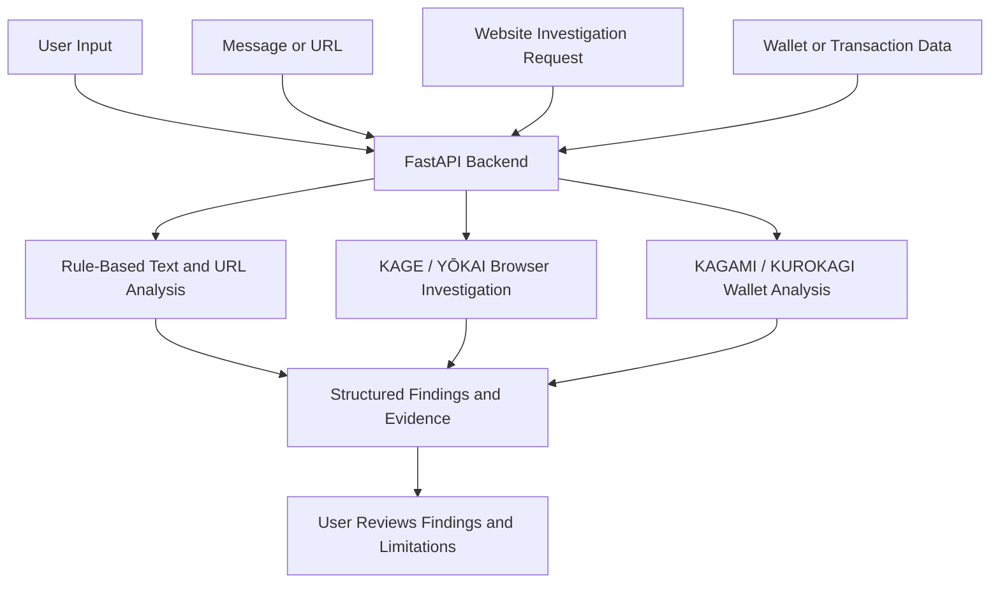

<div align="center">

# SCAMurai

### Evidence-First Web and Cryptocurrency Security Investigations

Investigate suspicious website behaviour, understand wallet permissions, and review security findings before acting.

**Python 3.11+ · FastAPI · Playwright · EVM-Compatible Blockchain Analysis**

</div>

---

> **Project status:** Under active development. Some investigation workflows require additional configuration, and some capabilities remain on the roadmap. Treat findings as security signals to review, not as proof of fraud or compromise.

## Overview

Traditional scam detection can miss websites that change their behaviour across devices or browser environments. At the same time, cryptocurrency wallet permissions can be difficult to understand when approvals and delegations are displayed separately.

**SCAMurai brings these investigation paths together in one platform.** It combines rule-based scam-message and URL analysis, controlled browser investigations, and wallet-permission analysis, with an emphasis on making supporting evidence understandable.

## Core Capabilities

### 1. KAGE / YŌKAI — Website Behaviour Investigation

Uses Playwright-based browser automation to compare how an authorised website behaves across selected browser profiles.

- Investigate behaviour that differs between environments, such as mobile and desktop.
- Review captured evidence and differential findings.
- Use controlled local fixtures for repeatable demonstrations.
- Identify suspicious forms, redirects, and behaviour that may depend on browser conditions.

### 2. KAGAMI / KUROKAGI — Wallet Authority Analysis

Examines supported wallet permissions and their relationships to help make potential exposure paths easier to understand.

- Inspect supported ERC-20 approvals, spender addresses, allowances, and delegations.
- Retrieve authority-graph information where supported.
- Decode supported transaction data.
- Preview supported transaction outcomes when network configuration is available.

### 3. Approval Timebomb — Allowance Risk Review

Highlights potentially risky outstanding token allowances, including permissions that may grant a spender broader access than expected.

The goal is to help users understand which permissions deserve closer review before interacting with a smart contract.

A finding is a prompt for review, not proof that a wallet has been compromised.

### 4. Wallet FutureView — Transaction Preview

Previews supported blockchain transaction outcomes before a user proceeds.

Results depend on the supported transaction type, network, RPC availability, and simulation limitations. A preview is not a guarantee of the final on-chain outcome.

### 5. Scam-Message and URL Analysis

The deterministic analysis endpoint checks submitted message text and statically parsed URLs for indicators such as:

- Urgency and pressure tactics.
- Impersonation and suspicious claims.
- Threats and unusual payment demands.
- Suspicious rewards and offers.
- Other rule-matched warning signs.

The endpoint returns matched signals and recommended actions without requiring an LLM for this analysis path.

**Risk scores are indicators, not probabilities of fraud.**

## Architecture



## Technology Stack

| Area | Technologies |
|---|---|
| Frontend | Next.js, TypeScript, Tailwind CSS, shadcn/ui, Lucide |
| Backend API | Python 3.11+, FastAPI, Pydantic, httpx |
| Browser Investigation | Playwright, Chromium |
| Scam Analysis | Deterministic rules, URL parsing, evidence extraction |
| Wallet Analysis | `eth-abi`, `eth-utils`, EVM-compatible data, Ethereum JSON-RPC |
| Testing | pytest, pytest-asyncio |
| Deployment | Vercel, Python API hosting, REST API |

## Getting Started

The following instructions assume that the repository contains a `backend/` directory and that the commands match your current branch.

### Prerequisites

- Python 3.11 or newer
- Git
- Playwright-supported Chromium for browser investigations
- An RPC endpoint for blockchain features that require network access

### 1. Clone the Repository

**Windows PowerShell**

```powershell
git clone --branch backend https://github.com/rithvik1509/SCAMurai.git
```

```powershell
Set-Location SCAMurai
```

**macOS / Linux**

```bash
git clone --branch backend https://github.com/rithvik1509/SCAMurai.git
```

```bash
cd SCAMurai
```

### 2. Create a Virtual Environment

**Windows PowerShell**

```powershell
py -3.11 -m venv backend/.venv
```

**macOS / Linux**

```bash
python3.11 -m venv backend/.venv
```

### 3. Upgrade pip

**Windows PowerShell**

```powershell
backend\.venv\Scripts\python.exe -m pip install --upgrade pip
```

**macOS / Linux**

```bash
backend/.venv/bin/python -m pip install --upgrade pip
```

### 4. Install Dependencies

**Windows PowerShell**

```powershell
backend\.venv\Scripts\python.exe -m pip install -r backend/requirements.txt
```

**macOS / Linux**

```bash
backend/.venv/bin/python -m pip install -r backend/requirements.txt
```

If your branch uses a different dependency-file name or location, replace `backend/requirements.txt` with the file present in that branch.

### 5. Install the Playwright Chromium Browser

**Windows PowerShell**

```powershell
backend\.venv\Scripts\python.exe -m playwright install chromium
```

**macOS / Linux**

```bash
backend/.venv/bin/python -m playwright install chromium
```

### 6. Start the API

Run the command from the repository root.

**Windows PowerShell**

```powershell
backend\.venv\Scripts\python.exe -m uvicorn backend.main:app --reload --port 8000
```

**macOS / Linux**

```bash
backend/.venv/bin/python -m uvicorn backend.main:app --reload --port 8000
```

These commands assume the FastAPI application is importable as `backend.main:app`. Check the actual application module in your branch if the command fails.

When the server starts, open:

- API health: http://127.0.0.1:8000/health
- Interactive API documentation: http://127.0.0.1:8000/docs

### 7. Run the Tests

**Windows PowerShell**

```powershell
backend\.venv\Scripts\python.exe -m pytest -q
```

**macOS / Linux**

```bash
backend/.venv/bin/python -m pytest -q
```

## Implementation Status

### Implemented

- FastAPI backend foundation.
- Request validation using Pydantic.
- Middleware and backend API structure.
- Deterministic message and URL analysis.

### In Progress or Configuration-Dependent

- YŌKAI browser investigations.
- KAGAMI wallet-permission analysis.
- Browser automation workflows requiring Chromium.
- Blockchain features requiring supported networks or RPC configuration.
- Frontend and backend integration.

### Planned

- Evidence-grounded AI-generated summaries.
- Correlation between related website and wallet findings.
- Continuous wallet-permission monitoring.
- Broader approval and delegation coverage.
- Additional transaction-simulation support.
- Browser-extension and wallet integrations.

Implementation status can change as features are integrated. Verify the current code and live API documentation before relying on a specific workflow.

## Safety and Security

- Investigate websites only when you own them or have explicit authorisation to test them.
- Prefer controlled local fixtures for demonstrations and automated tests.
- Review the evidence and limitations behind each finding. Automated analysis can produce false positives or miss threats.
- Never provide a private key or seed phrase to analyse a public wallet address or transaction.
- Keep RPC credentials and other secrets out of source control.
- Restrict CORS to trusted frontend origins in production.
- Disable local fixtures and unrestricted public-target investigation options in production.
- Treat transaction previews as estimates rather than guarantees of final blockchain execution.

## API Endpoint Reference

The following routes describe the intended API surface. Availability and exact request and response schemas depend on the current backend implementation.

<details>
<summary><strong>View API endpoints</strong></summary>

| Method | Endpoint | Purpose |
|---|---|---|
| `GET` | `/health` | Basic service health. |
| `POST` | `/api/v1/analyze` | Rule-based scam-message and static URL analysis. |
| `GET` | `/api/v1/kage/health` | Check browser-worker readiness. |
| `GET` | `/api/v1/kage/capabilities` | List available investigation capabilities. |
| `POST` | `/api/v1/kage/investigations` | Start an authorised investigation. |
| `GET` | `/api/v1/kage/investigations/{id}` | Retrieve investigation status and results. |
| `GET` | `/api/v1/kage/investigations/{id}/comparison` | Retrieve differential findings. |
| `POST` | `/api/v1/kagami/wallets/analyze` | Analyse supported wallet permissions. |
| `GET` | `/api/v1/kagami/wallets/{id}/authority` | Retrieve authority-graph data where available. |
| `GET` | `/api/v1/kagami/wallets/{id}/approvals` | Retrieve supported token approvals. |
| `GET` | `/api/v1/kagami/wallets/{id}/delegations` | Retrieve supported delegation data. |
| `POST` | `/api/v1/kagami/transactions/decode` | Decode supported transaction input. |
| `POST` | `/api/v1/kagami/transactions/preview` | Preview a supported transaction when configured. |

For the authoritative route list and schemas, check the live `/docs` page after starting the API.

</details>

## Configuration

Local environment values may be placed in `backend/.env`, depending on the active branch and settings implementation.

Potential configuration areas include:

- Runtime environment and logging level.
- Allowed frontend origins for CORS.
- Ethereum or other supported-network RPC endpoint URLs.
- Network allowlists for transaction previews and approval analysis.
- Allowed website-investigation targets.
- Local-fixture and browser-investigation settings.

Configure only the settings supported by the code in your branch. Never commit API credentials, access tokens, private keys, seed phrases, or other secrets.

## Roadmap

- Expand browser-profile coverage and controlled counterfactual testing.
- Improve wallet-permission dependency mapping and exposure explanations.
- Add support for additional allowance and delegation mechanisms, including Permit2 and NFT operator approvals.
- Explore continuous monitoring for relevant wallet-permission changes.
- Extend EVM network and transaction-simulation coverage.
- Add evidence-grounded AI summaries and correlations between website and wallet findings.
- Complete planned browser-extension and wallet integrations.

